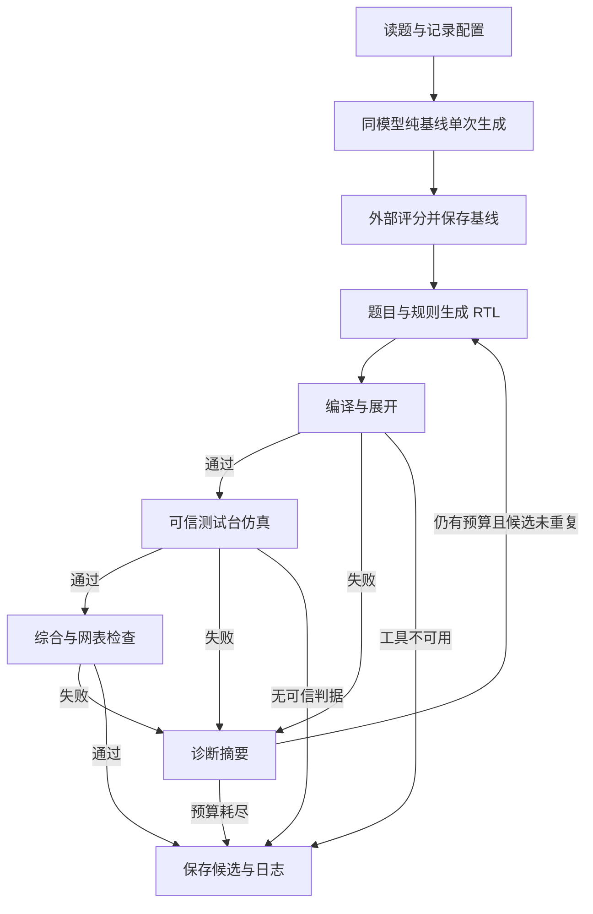

# 开发协议与控制流

## 输入

单题使用 UTF-8 JSON。`task_id` 为题目标识，`prompt` 为题目原文，`top` 为顶层模块名；可选 `clock_port`。可选 `testbench_files`（相对于任务文件的位置解析）、`testbench_top`、`simulation_pass_marker` 指向可信开发测试台。示例见 `examples/counter.json`。

加载器把实际测试台的 SHA-256 加入任务摘要：决定"通过"含义的是测试台内容，不是它的路径，所以原地改写测试台必须改变 `task_digest`。没有这一步时两个内容不同的测试台会共用一个身份，混进同一个 pass@k 池并互相配对，而且完全静默。导入任务还可声明 `source_sha256`（按文件名匹配）用于拒绝与上游不一致的测试台；声明后缺失或不可读按错误处理，未声明时缺失测试台仍交给验证器报告，不在加载阶段伪造内容身份。摘要包含规范化绝对路径，搬迁目录后摘要会改变，不自动合并跨目录结果。

模型只收到 prompt；agent 额外收到规则及上一轮设计/诊断。不会把测试台源码或参考实现作为模型上下文。传入测试台代表该开发环境允许使用其反馈；正式盲测须按官方协议剥离不允许的信息。

当前输入格式与 CLI 是本项目开发约定。官方读题路径、输出文件名、批任务与预算协议到位后，新增边缘适配层，不修改核心策略来适应隐藏题答案。

## 输出

每次运行创建新目录：`task.json`、`config.json`、`result.json`、最终 `design.sv`，以及每轮 `attempt_XX/request.json`、`response.json`、`design.sv` 和 EDA 原始日志。模型完全失败时可以没有 `design.sv`，错误明确写入 result。

`result.json` 包括 mode、evaluation_kind、paired_run_id、task_digest、config_digest、seed、wall_s、attempts、selected_attempt 和 validation。配置摘要包含相同的模型、上下文、采样与策略预算；代码、技能和权重另用完整冻结清单标识，比较实验时必须保持其版本一致。

`seed` 是运行种子，只作运行身份；每次生成实际发出的模型采样种子另记为 `seed * 1000 + (尝试序号 - 1)`，逐条落在 `attempts[].seed` 并在 `sampling_seeds` 汇总，便于直接核对。这样不同运行种子的修复轮次不会共用采样种子：若用 `seed + 尝试序号 - 1`，`--seeds 0 1 2 3 4` 的 15 次尝试只会覆盖 7 个种子，独立运行在采样层面就已互相复用。配置需满足 `max_attempts` 不超过该进位基数。

| 验证状态 | 含义 |
|---|---|
| passed | 在本地可信测试协议下完成全部三级 |
| failed | 已执行的验证明确失败 |
| unavailable | 工具/版本不符合要求，或测试台在加载后被改动，不能判为代码不正确 |
| unverified | 缺少测试台/通过判据或未运行验证 |

EDA 复制测试台后重新核对实际工作文件与 `asset_sha256`：加载后改动、复制期间改动、缺失或哈希格式非法时返回 unavailable，工具不启动，不把环境资产错误计为模型功能失败。校验不能代替操作系统隔离，正式运行仍应冻结输入。

`highest_stage`：0 未通过编译；1 编译/展开通过；2 再通过仿真；3 再通过综合。`evaluation_kind=mock` 一律不作为能力评测。

## 状态机

agent 默认最多生成 3 次，含初次生成；每次完整运行默认 180 秒，单次 EDA 最多 60 秒且受剩余运行时间限制。基线生成也受 180 秒限制，配对脚本中其外部评分另有最多 60 秒。配对总墙钟单独记录；**这些是暂定开发预算，不是官方预算**。HTTP 使用 POSIX 主线程绝对时限覆盖完整请求；已有实时定时器或非主线程调用会明确拒绝；严格进程/CPU/内存预算仍须由容器评测器强制执行。

这 60 秒由 `vivado -version`、`xvlog`、`xelab`、`xsim`、`synth_design` 五个调用**共用**，且综合排在最后，因此真实综合耗时一旦超过剩余额度，第三级就永远拿不到。预算的实测校准流程、判定口径与代价权衡见 [EDA 时间预算](eda_budget.md)；**在真机实测完成前不得修改这两个数值**。两个 track 的预算不可互相照抄：HLS 的单次 tool 额度覆盖一次调用，RTL 的同一额度要覆盖五次调用中的全部阶段。

EDA 超时一律记为 `status: failed`（进入分母，且不会成为 `highest_stage: 3`），并额外写入 `failure_cause` 与 `budget_exhausted`，用于把"时间预算耗尽"与"设计错误"分开；设计错误不写这两个字段。三个 stage 记录的键保持 `name`/`status`/`reason`/`wall_s`/`log` 不变。

模型历史仅保留原题、规则、最近候选与最多 2000 字符诊断；使用 UTF-8 字节数进行保守上下文预检，超限明确报错，绝不悄悄截断原题。字节预检不等同于真实 tokenizer 计数，服务端还须强制 max_model_len；部署验收应测试长题与长代码。

基线仅格式化提取代码围栏，规则与 agent 相同，没有语义修复。工具运行由程序定义的固定参数数组发起，不接受模型生成的命令。EDA adapter 是流程适配器，不能代替操作系统隔离；正式执行依赖官方断网沙箱。

## pass@k 与耗时

一次完整 agent 运行（含允许的内部修复）只产生一个样本。对同题、同模式和同配置的 n 次独立运行，某级成功 c 次，开发统计采用 `1 - C(n-c,k)/C(n,k)`；n 小于 k 时不报告该值。保持独立种子、固定采样配置，不按效果挑选或删除失败样本。最终是否使用该估计及官方允许的内部修复方式，必须依后续细则调整。

基线模型入口不调用工具；配对脚本的评分不向基线模型反馈，也不把基线生成内容传给 agent。跨运行统计应检查任务、数据集、模型、服务与冻结包完全一致，mock 和无法判定项分开报告，不能只展示排除后的有利分母。

汇总同时比较 task_id 和 task_digest，不混合同名但内容不同的题目。独立运行必须显式使用不同 seed；同一题目/配置/模式下重复 seed 会排除并单列原因，不能靠不同配对 UUID 增加样本量。没有 paired_run_id 的单独运行可做单模式统计，但不能计算配对增益。不同 seed 只是必要检查，仍需控制模型版本、服务状态和实验条件，不能从元数据证明完全独立。

## 第二轮扩展

批预检、覆盖率、诊断统计、重复尝试记账及兼容说明见 [optimization_round2.md](optimization_round2.md)。新增字段不改变纯基线只生成一次、mock 不进入性能统计的约定。

## 2026-10-14 审计修复统计与来源绑定

`track_summary` 按题平均；`planned_performance` 保留 batch 计划中缺失/未知/被排除槽的分母，报告保守估计与覆盖数。单独结果没有计划时明确报告计划分母未知。real 记录必须携带 HTTP 来源摘要，批处理来源还须与快照一致；来源哈希是完整性检查，不是服务器认证。新旧证据兼容、字段与预算剩余验证详见 [审计修复记录](audit_fixes_20261014.md)。
